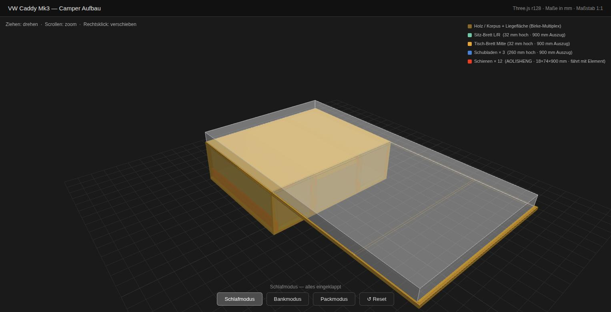
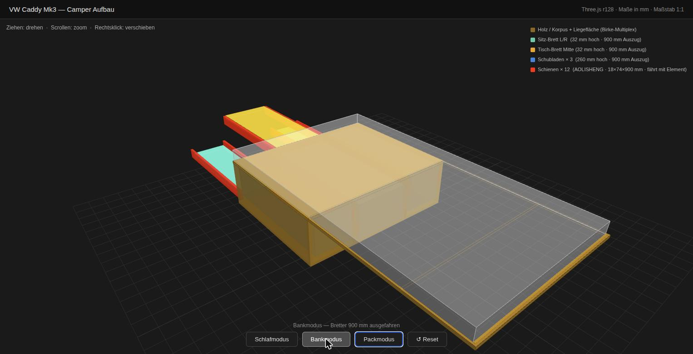
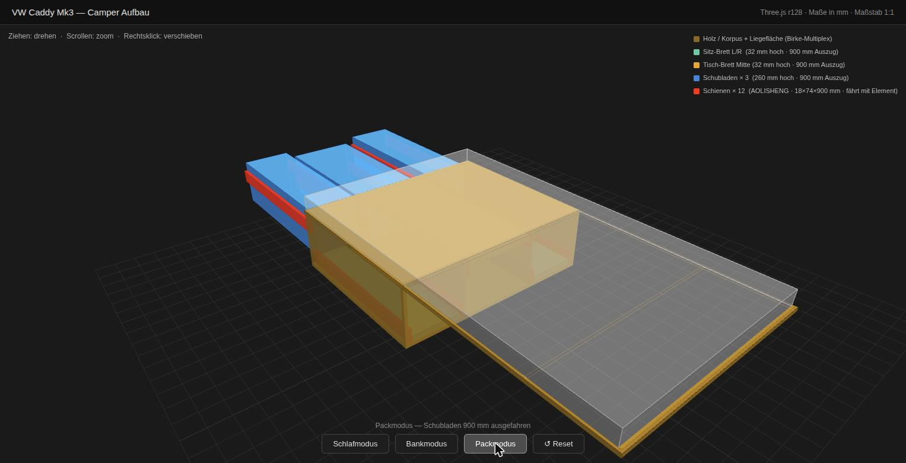

# VW Caddy Mk3 — Camper Aufbau 3D Viewer

Interaktiver 3D-Viewer zur Planung des Camper-Ausbaus eines VW Caddy Mk3 (2010–2015).  
Gebaut mit [Three.js r128](https://threejs.org) — keine Installation, kein Build-Tool, direkt im Browser öffnen.

**Live-Demo: [dbraun1991.github.io/Caddy-Camper-Construction](https://dbraun1991.github.io/Caddy-Camper-Construction/)**

---

## Dateien

```
index.html                  — Viewer: Reiter „Dynamisch · 3D“ und „Statisch · Werkzeichnungen“
modell/parameter.json       — gemeinsame Datenbasis: alle Hauptmaße (mm)
modell/modell.py            — leitet daraus alle Bauteile + Überschneidungen ab → modell/modell.js
modell/zeichnungen.py       — Werkzeichnungen mit build123d → docs/zeichnungen/
List_of_Materials.md        — Holzteile, Schienen, Befestigungsmaterial, Verbindungstechnik
Einkaufsliste.md            — Einkaufsliste, Preise und Gesamtbudget
Hinweise-Sommernutzung.md   — Rechtliches, Zuladung, Lüftung, Sicht-/Insektenschutz (Sommerbetrieb)
README.md
docs/adrs/                   — Architecture Decision Records
docs/pics/                   — Screenshots des Viewers
docs/zeichnungen/            — Draufsicht, Vorderansicht, Seitenansicht (SVG, A3, 1:5) je Eckausbildung
```

→ Vollständige Stückliste, Maßtabellen, Schienen-Optionen und **Verbindungstechnik**: **[List_of_Materials.md](./List_of_Materials.md)**

---

## Starten

```bash
# einfach im Browser öffnen
open index.html
```

Einzige Voraussetzung: Internetverbindung beim ersten Öffnen (Three.js wird per CDN geladen).

---

## Bedienung

| Aktion | Steuerung |
|---|---|
| Drehen | Linksklick + Ziehen |
| Zoomen | Scrollrad · Touch: Pinch (zwei Finger) |
| Drehen (Touch) | Ein Finger ziehen |
| Caddy-Hülle ein-/ausblenden | Button „Caddy-Hülle“ (transparente Fahrzeugkarosserie, Heckklappe hochgeklappt) |
| Rücksitze umgeklappt / ausgebaut | Button „Rücksitze“ |
| Ansicht zurücksetzen | Reset-Button (Standardansicht: von hinten rechts, Caddy-Hülle sichtbar) |
| Überschneidungen anzeigen | Button „Überschneidungen“ — rot, bezogen auf den eingefahrenen Zustand |
| Werkzeichnungen | Reiter „Statisch · Werkzeichnungen“ (oben rechts), direkt verlinkbar mit `index.html#statisch` |

### Modi

Alle 6 beweglichen Elemente (3 Schubladen + 2 Sitz-Bretter + 1 Tisch-Brett) sind in jedem Modus als vollständige 3D-Körper sichtbar. Der Modus bestimmt ihre Position — eingeklappt (im Korpus) oder ausgefahren (in −z-Richtung vor dem Fahrzeugheck).

| Modus | Schubladen | Sitz-Bretter L/R + Tisch-Brett M |
|---|---|---|
| **Schlafmodus** | eingeklappt | eingeklappt |
| **Bankmodus** | eingeklappt | 850 mm ausgefahren |
| **Packmodus** | 850 mm ausgefahren | eingeklappt |

Die Führungsschienen-Innenmember (rot) sind immer Teil der 3D-Geometrie und fahren mit ihrem Element mit — im eingeklappten Zustand liegen sie verdeckt im Korpus, im ausgefahrenen Zustand werden sie sichtbar.

---

## Screenshots

| Schlafmodus | Bankmodus | Packmodus |
|---|---|---|
| [](docs/pics/schlafmodus.jpg) | [](docs/pics/bankmodus.jpg) | [](docs/pics/packmodus.jpg) |
| alles eingeklappt | Sitz-/Tisch-Bretter ausgefahren (Screenshot noch mit 900 mm) | Schubladen ausgefahren (Screenshot noch mit 900 mm) |

---

## Werkzeichnungen

Drei Ansichten nach Dreitafelprojektion, DIN A3 quer, Maßstab 1:5, erzeugt mit [build123d](https://github.com/gumyr/build123d) aus derselben Datenbasis wie der 3D-Viewer:

| Ansicht | Blickrichtung | Ist-Stand Stückliste |
|---|---|---|
| **Vorderansicht** (Aufriss) | von der Heckklappe auf die offene Korpusfront | [SVG](docs/zeichnungen/stueckliste/vorderansicht.svg) |
| **Draufsicht** (Grundriss) | von oben, Deckel A1 abgenommen | [SVG](docs/zeichnungen/stueckliste/draufsicht.svg) |
| **Seitenansicht** (Seitenriss) | von der Fahrerseite | [SVG](docs/zeichnungen/stueckliste/seitenansicht.svg) |

Sichtbare Kanten durchgezogen, verdeckte Kanten gestrichelt. **Rot hinterlegt** sind rechnerische Überschneidungen zweier Bauteile — Stellen, an denen der Plan so nicht baubar ist. Dieselben Blätter gibt es für die Eckausbildungs-Varianten `boden_durchlaufend` und `seiten_durchlaufend` (Ordner nebenan, im Viewer per Auswahlfeld).

Neu erzeugen nach einer Maßänderung in `modell/parameter.json`:

```bash
python3 modell/modell.py                                   # Viewer-Daten, ohne Zusatzpakete
python3 -m venv .venv && .venv/bin/pip install -r modell/requirements.txt   # einmalig
.venv/bin/python modell/zeichnungen.py                     # Zeichnungen (--png für zusätzliche PNGs)
```

> Entscheidungsprotokoll: [ADR 0015](docs/adrs/0015-shared-model-data-for-viewer-and-drawings.md)

---

## Aufbau / Maße

Basis: VW Caddy Mk3 Kombi, Erstzulassung 05/2012, Laderaumbreite nutzbar **1.120 mm**.

**Am Fahrzeug nachgemessen (2026-10-17):** Breite zwischen den Radkästen 1.130–1.140 mm (Korpus bleibt bewusst 1.120 mm, 10–20 mm Spiel) · Box 1.120 × 900 × 338 mm passt durch die Heckklappe, keine Ladekante · Ladetiefe bis zu den Rücksitzen 920–930 mm · Boden eben · umgeklappte Rücksitzlehnen 310 mm hoch · Heck → Kopfstützen 2.000 mm. Details: [List_of_Materials.md → Fahrzeugmaße](./List_of_Materials.md#fahrzeugmaße-am-eigenen-fahrzeug-nachgemessen-2026-10-17). Im Viewer prüft der Reiter „Statisch“ den Plan automatisch gegen diese Werte.

### Unterbau (Kofferraum)

| Maß | Wert |
|---|---|
| Breite | 1.120 mm |
| Tiefe | 900 mm |
| Höhe | 320 mm (= Ladebodenhöhe → Plattform) |
| Wandstärke | 18 mm Birke-Multiplex |

### 3 Sektionen (Breite)

Nutzbare Innenhöhe: 320 mm − 18 mm Bodenplatte = **302 mm**.

Sektionsbreiten nach Abzug B2-Seitenwände (18 mm innen): **312 mm** L/R · **424 mm** Mitte.

| Sektion | Innenbreite | Element oben | Element unten |
|---|---|---|---|
| Links | 312 mm | Schublade 268 mm hoch · 272 mm breit | Sitz-Brett 32 mm hoch · 272 mm breit |
| Mitte | 424 mm | Tisch-Brett 32 mm hoch · 384 mm breit | Schublade 268 mm hoch · 384 mm breit |
| Rechts | 312 mm | Schublade 268 mm hoch · 272 mm breit | Sitz-Brett 32 mm hoch · 272 mm breit |

Breitenformel: Innenbreite − 2 × 19 mm Schiene − 2 mm Spalt = Elementbreite.  
Schienenstärke (AOLISHENG 850 mm): 19 mm je Seite — vor der Bestellung am Produkt prüfen. Im Render dunkelgrau dargestellt.

Alle Elemente fahren auf **Vollauszug-Schienen 850 mm Schwerlast** aus ([ADR 0017](docs/adrs/0017-850-mm-runners-in-900-mm-corpus.md)): Korpus 900 mm − Rückwand 18 mm = 882 mm lichte Tiefe → 32 mm Luft hinter Schienen, Kästen (830 mm) und Brettern (850 mm).

### Liegefläche (gesamt ~2.000 mm)

| Segment | Länge | Funktion |
|---|---|---|
| Unterbau-Deckel | 900 mm | Fest, über Kofferraum |
| Brett 1 | 700 mm | Auf umgeklappten Rücksitzlehnen (310 mm hoch → 10 mm Ausgleich) |
| Brett 2 | 400 mm | Kopfbereich, 2 Gurtschlaufen um die Vordersitz-Kopfstützen |

Matratzenbreite: **1.100 mm** (passt in 1.120 mm Innenbreite).

---

## Farblegende

| Farbe | Bedeutung |
|---|---|
| Dunkelbraun (transparent) | Holz / Korpus + Liegefläche (B1, B2, B3, B4, A1–A3 · Birke-Multiplex) |
| Türkis (transparent) | Sitz-Brett L/R (C1, C2) |
| Orange (transparent) | Tisch-Brett Mitte (C3) |
| Blau (transparent) | Schubladen × 3 |
| Rot (transparent) | Führungsschienen-Innenmember — fahren mit Element aus |
| Weiß (transparent) | Matratzenumriss |
| Hellblau-grau (60 % deckend) | Caddy-Hülle mit Türöffnungen und offener Heckklappe (Ladebreite, Lehnenhöhe und Länge nachgemessen, übrige Maße Platzhalter) |
| Hellgrün (transparent) | Lade-Referenzebene im Kofferraum (y = 0) |
| Schiefergrau (transparent) | Rücksitzbank (umgeklappt oder ausgebaut) |

---

## Technologie

- [Three.js r128](https://cdnjs.cloudflare.com/ajax/libs/three.js/r128/three.min.js) via CDN
- Kein Framework, kein Build-Schritt
- Funktioniert in jedem modernen Browser (Chrome, Firefox, Safari, Edge)
- Touch-Steuerung für mobile Geräte unterstützt

### Render-Architektur

> Entscheidungsprotokolle: [ADR 0004](docs/adrs/0004-static-scene-graph-with-z-position-toggle.md) (Szenengraph), [ADR 0009](docs/adrs/0009-translucent-caddy-shell-overlay.md) (Caddy-Hülle), [ADR 0015](docs/adrs/0015-shared-model-data-for-viewer-and-drawings.md) (gemeinsame Datenbasis)

Alle Bauteile kommen aus `MODELL.teile` (`modell/modell.js`) — jeweils ein Quader in mm, im eingefahrenen Zustand. Der Viewer enthält keine eigenen Bauteilmaße mehr; nur die Caddy-Hülle ist weiterhin direkt in `index.html` definiert.

Alle Elemente — Korpusbretter, Liegefläche, Schubladen, Sitz-/Tischbretter und Führungsschienen — leben permanent in der statischen Szenengruppe `sg`. Beim Moduswechsel wird nur die Z-Position der 6 Elemente plus ihrer jeweils zugehörigen Schienen-Innenmember verschoben.

```
sg    — Korpus (B1, B2, B3, B4), Liegefläche (A1–A3), Matratze,
        alle 6 Elemente + 12 Führungsschienen-Innenmember (immer sichtbar)
bankG — (leer, reserviert)
packG — (leer, reserviert)
caddyG — transparente Caddy-Hülle (Wände mit Türöffnungen, Dach, Radkästen, Vordersitze, Lade-Referenzebene, Rücksitzbank), per Button ausblendbar
```

Der Korpus besteht aus Einzelbrettern (keine Vollbox): B2 links/rechts, B1 Rückwand, B4 Boden, B3 × 2 Trennwände. Die Vorderseite ist offen.

---

## Weiterführende Planung

- [x] Verbindungstechnik Korpus — [List_of_Materials.md §H](./List_of_Materials.md#h--verbindungstechnik) · [ADR 0007](docs/adrs/0007-dowel-screw-bracket-joinery.md)
- [x] Schubladendetails (Kastenbau, Frontblende, Griffe) — [§H2/§H3](./List_of_Materials.md#h2--schubladenkästen-d1d3) · [ADR 0011](docs/adrs/0011-drawer-box-panel-shear-joinery.md)
- [x] Schienenbefestigung an Wänden und Trennwänden — [§H1](./List_of_Materials.md#h1--schienenbefestigung-an-wänden-und-trennwänden)
- [x] Befestigung Unterbau im Fahrzeug — Rücksitz-Ösen neben dem Korpus, Winkel außen an B2 — [§H5](./List_of_Materials.md#h5--befestigung-des-korpus-im-fahrzeug) · [ADR 0012](docs/adrs/0012-non-destructive-vehicle-tie-down.md) · [ADR 0016](docs/adrs/0016-rear-lashing-eyes-carry-the-hold-down.md)
- [x] Brett 3 (A3) an den Vordersitz-Kopfstützen: 2 verstellbare Gurtschlaufen — [§H4](./List_of_Materials.md#h4--liegefläche-stöße-a1--a2--a3)
- [x] Fahrzeug nachgemessen (Breite, Heckklappe, Tiefe, Lehnenhöhe, Länge, Zurrösen) — [List_of_Materials.md](./List_of_Materials.md#fahrzeugmaße-am-eigenen-fahrzeug-nachgemessen-2026-10-17)
- [x] Budget und Kaufreihenfolge — [Einkaufsliste.md](./Einkaufsliste.md)
- [x] Rechtliches (Rasten vs. Campen), Zuladung, Lüftung (CO₂ + Hitze), Sicht-/Insektenschutz für Sommerbetrieb — [Hinweise-Sommernutzung.md](./Hinweise-Sommernutzung.md)

Offen:

- [ ] **Entscheidung ADR 0013** — Schienenhöhe (76 mm, überall AOLISHENG 850) vs. Brettstärke (32 mm) bei C1–C3: [docs/adrs/0013-rail-carrier-cheeks-for-seat-and-table-boards.md](docs/adrs/0013-rail-carrier-cheeks-for-seat-and-table-boards.md). Blockiert den Zuschnitt von C1–C3, nicht mehr den Schienenkauf.
- [ ] **Eckausbildung Korpus** — Stückliste nennt B2/B3 320 mm hoch *und* B4/B1 1.120 mm breit; das überschneidet sich an allen Ecken. Varianten im Reiter „Statisch“ vergleichen, dann Stückliste anpassen. **Vor dem Zuschnitt von B1–B4 klären.**
- [x] Lichte Tiefe 882 mm vs. Schienenlänge — gelöst mit 850-mm-Schienen, Korpus bleibt 900 mm (20–30 mm Luft zu den Rücksitzen, 32 mm hinter den Schienen) — [ADR 0017](docs/adrs/0017-850-mm-runners-in-900-mm-corpus.md)
- [ ] Schienenstärke der 850-mm-Schiene prüfen (geplant 19 mm je Seite) — vor der Bestellung
- [ ] **Frontblenden vs. Schienen** — Blenden sind so breit wie die Sektion (312/424 mm) und sitzen als einliegende Front vor den Schienen; einliegend mit Luft oder aufliegend klären
- [ ] Schubladenhöhe: Kasten 260 mm (248 + 12 Boden) und Blende 268 mm passen zueinander; offen bleibt D3-Blende (bis y 286) vs. Tisch-Brett C3 (ab y 283, Viewer) bzw. 286 (Stückliste) — 3 mm Überschneidung
- [ ] Bezeichnung „links/rechts“: Sektion L liegt bei −x = **Beifahrerseite**. Ggf. in der Stückliste umbenennen, damit L beim Blick durch die Heckklappe links liegt
- [ ] Matratze (1.100 mm ist kein Handelsmaß — Varianten in [Einkaufsliste.md §4](./Einkaufsliste.md#4--ausbau--sonstiges))
- [ ] Zuladung im Zulassungsschein prüfen (Feld F.1 − Leergewicht) — siehe [Hinweise-Sommernutzung.md §2](./Hinweise-Sommernutzung.md#2--zulassung--stvzo-serienfahrzeug-bleibt-verkehrssicher)
- [ ] Belüftung / Feuchteschutz Unterbau — **nur für Nutzung außerhalb des Sommers relevant**, siehe [Hinweise-Sommernutzung.md](./Hinweise-Sommernutzung.md) (dort bewusst ausgeklammert)
- [ ] 12V-Anschluss / Beleuchtung
