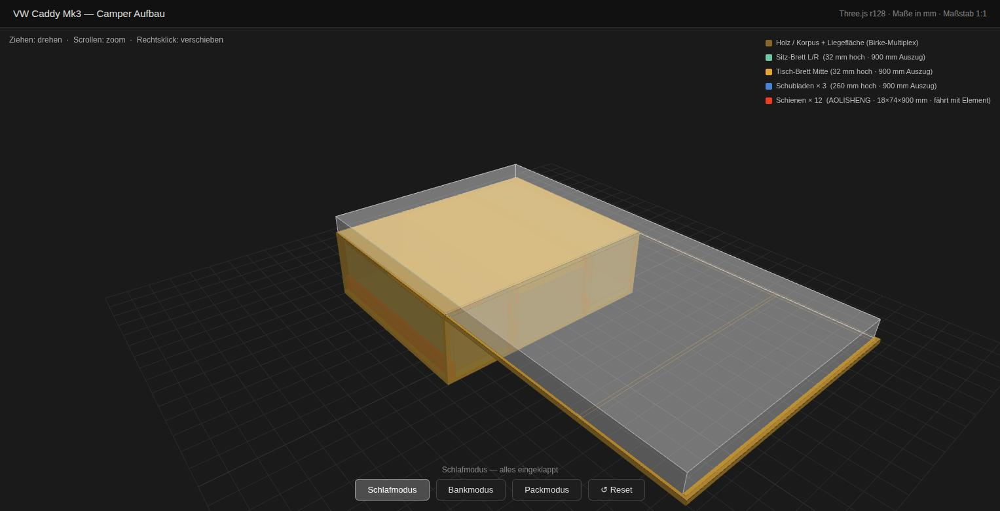
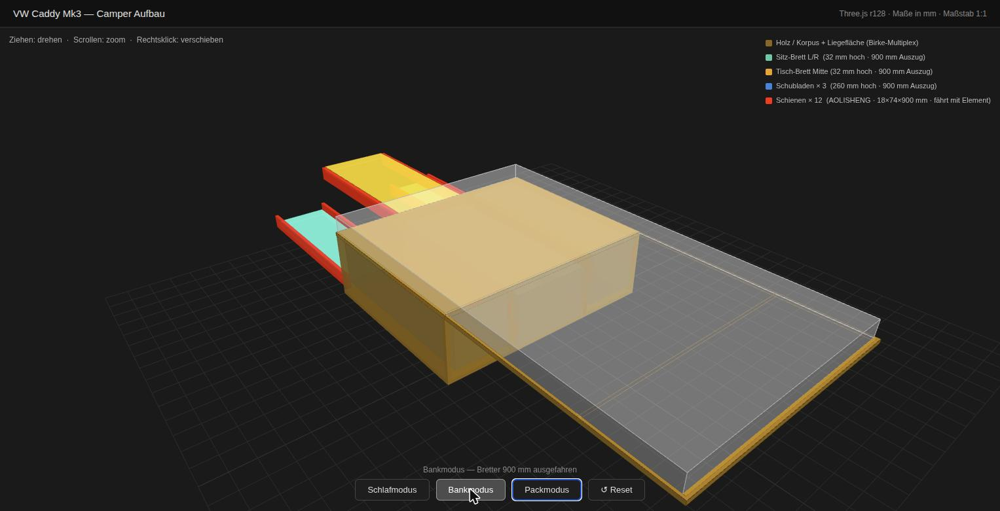
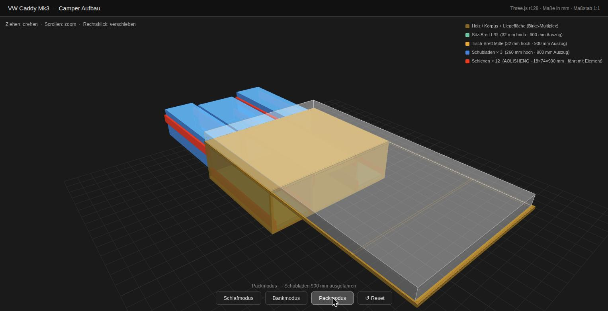

# VW Caddy Mk3 — Camper Aufbau 3D Viewer

Interaktiver 3D-Viewer zur Planung des Camper-Ausbaus eines VW Caddy Mk3 (2010–2015).  
Gebaut mit [Three.js r128](https://threejs.org) — keine Installation, kein Build-Tool, direkt im Browser öffnen.

**Live-Demo: [dbraun1991.github.io/Caddy-Camper-Construction](https://dbraun1991.github.io/Caddy-Camper-Construction/)**

---

## Dateien

```
index.html                  — Viewer: Reiter „Dynamisch · 3D“, „Statisch · Werkzeichnungen“ und „DXF · CNC“
modell/parameter.json       — gemeinsame Datenbasis: alle Hauptmaße (mm)
modell/modell.py            — leitet daraus alle Bauteile + Überschneidungen ab → modell/modell.js
modell/zeichnungen.py       — Werkzeichnungen mit build123d → docs/zeichnungen/
modell/cnc.py               — CNC-Dateien (DXF) + Auftrag für den Fräs-Dienstleister → docs/cnc/
List_of_Materials.md        — Holzteile, Schienen, Befestigungsmaterial, Verbindungstechnik
Einkaufsliste.md            — Einkaufsliste, Preise und Gesamtbudget
Hinweise-Sommernutzung.md   — Rechtliches, Zuladung, Lüftung, Sicht-/Insektenschutz (Sommerbetrieb)
README.md
docs/adrs/                   — Architecture Decision Records
docs/pics/                   — Screenshots des Viewers
docs/zeichnungen/            — Draufsicht, Vorderansicht, Seitenansicht, Box-Bretter, Einzelbretter (SVG, A3) je Eckausbildung
```

→ Vollständige Stückliste, Maßtabellen, Schienen-Optionen und **Verbindungstechnik**: **[List_of_Materials.md](./List_of_Materials.md)**

---

## Starten

```bash
# einfach im Browser öffnen
open index.html
```

Einzige Voraussetzung: Internetverbindung beim ersten Öffnen (Three.js wird per CDN geladen).

---

## Bedienung

| Aktion | Steuerung |
|---|---|
| Drehen | Linksklick + Ziehen |
| Zoomen | Scrollrad · Touch: Pinch (zwei Finger) |
| Drehen (Touch) | Ein Finger ziehen |
| Caddy-Hülle ein-/ausblenden | Button „Caddy-Hülle“ (transparente Fahrzeugkarosserie, Heckklappe hochgeklappt) |
| Rücksitze umgeklappt / hochgeklappt / ausgebaut | Button „Rücksitze“ (Fahrmodus 2 klappt sie automatisch hoch) |
| Ansicht zurücksetzen | Reset-Button (Standardansicht: von hinten rechts, Caddy-Hülle sichtbar) |
| Überschneidungen anzeigen | Button „Überschneidungen“ — rot, bezogen auf den eingefahrenen Zustand |
| Legende ein-/ausblenden | Button „Legende“ — am Handy (≤ 700 px Breite) standardmäßig ausgeblendet, weil sie sonst die Szene verdeckt |
| Werkzeichnungen | Reiter „Statisch · Werkzeichnungen“ (oben rechts), direkt verlinkbar mit `index.html#statisch` |
| CNC-Dateien | Reiter „DXF · CNC“: Vorschau jeder DXF, Download und alle Hinweise zum Auftrag, direkt verlinkbar mit `index.html#cnc` |

### Modi

Alle 6 beweglichen Elemente (3 Schubladen + 2 Sitzbretter + 1 Tischbrett) sind in jedem Modus als vollständige 3D-Körper sichtbar. Der Modus bestimmt ihre Position — eingeklappt (im Korpus) oder ausgefahren (in −z-Richtung vor dem Fahrzeugheck).

| Modus | Schubladen | Sitzbretter L/R + Tischbrett M |
|---|---|---|
| **Schlafmodus** | eingeklappt | eingeklappt |
| **Bankmodus** | eingeklappt | 850 mm ausgefahren |
| **Packmodus** | 850 mm ausgefahren | eingeklappt |
| **Fahrmodus 1** | eingeklappt | eingeklappt — Klappbretter (F1, F2) auf die Deckplatte geklappt, Matratze verstaut |
| **Fahrmodus 2** | eingeklappt | wie Fahrmodus 1, Rücksitze hochgeklappt → 5 Sitzplätze |

Die Klappbretter hängen an Klappscharnieren: Deckplatte ↔ Klappbrett Rücksitz oben, Klappbrett Rücksitz ↔ Klappbrett Kopfende unten. So klappen beide als Stapel auf die Box (Klappbrett Rücksitz umgedreht auf der Deckplatte, Klappbrett Kopfende darauf, Stapelhöhe 386 mm) — [ADR 0019](docs/adrs/0019-hinged-sleeping-boards-fold-onto-the-corpus.md). Beim Fahren den Stapel mit einem Spanngurt sichern.

Die Führungsschienen-Innenmember (rot) sind immer Teil der 3D-Geometrie und fahren mit ihrem Element mit — im eingeklappten Zustand liegen sie verdeckt im Korpus, im ausgefahrenen Zustand werden sie sichtbar.

---

## Screenshots

| Schlafmodus | Bankmodus | Packmodus |
|---|---|---|
| [](docs/pics/schlafmodus.jpg) | [](docs/pics/bankmodus.jpg) | [](docs/pics/packmodus.jpg) |
| alles eingeklappt | Sitz-/Tischbretter ausgefahren (Screenshot noch mit 900 mm) | Schubladen ausgefahren (Screenshot noch mit 900 mm) |

---

## Werkzeichnungen

Ein Übersichtsblatt „Bezeichnungen“, drei Ansichten nach Dreitafelprojektion (DIN A3 quer, Maßstab 1:5), ein Zuschnittblatt „Box-Bretter“ (1:10) und drei Einzelbrett-Blätter (1:5) zum Sägen, erzeugt mit [build123d](https://github.com/gumyr/build123d) aus derselben Datenbasis wie der 3D-Viewer:

| Ansicht | Blickrichtung | Wände gezapft |
|---|---|---|
| **Bezeichnungen** (Blatt 1, Übersicht) | Isometrie der Box mit allen Brett-Kürzeln, Tabelle aller Kürzel mit Langnamen | [SVG](docs/zeichnungen/gezapft/bezeichnungen.svg) |
| **Vorderansicht** (Aufriss) | von der Heckklappe auf die offene Korpusfront | [SVG](docs/zeichnungen/gezapft/vorderansicht.svg) |
| **Draufsicht** (Grundriss) | von oben, Deckplatte T1 abgenommen | [SVG](docs/zeichnungen/gezapft/draufsicht.svg) |
| **Seitenansicht** (Seitenriss) | von der Fahrerseite | [SVG](docs/zeichnungen/gezapft/seitenansicht.svg) |
| **Box-Bretter** (Zuschnitt, 1:10) | jede Platte der Box und der Liegefläche einzeln, mit Maß, Stückzahl, Zapfen, Schlitzen und Zuschnittliste | [SVG](docs/zeichnungen/gezapft/box-bretter.svg) |
| **Bodenplatte B1 / Deckplatte T1** (1:5) | Boden- und Deckplatte zum Sägen: jeder Schlitz und jede Aussparung bemaßt, Abfall grau | [SVG](docs/zeichnungen/gezapft/brett-b1-t1.svg) |
| **Seitenwände S1/S2 + Trennwände M1/M2** (1:5) | Seiten- und Trennwände: Zapfen oben/unten, Absatz und hinterer Zapfen an M1/M2 bemaßt | [SVG](docs/zeichnungen/gezapft/brett-s-m.svg) |
| **Rückwand R1** (1:5) | Rückwand: Zapfen und die zwei Schlitze für M1/M2 bemaßt | [SVG](docs/zeichnungen/gezapft/brett-r1.svg) |

Sichtbare Kanten durchgezogen, verdeckte Kanten gestrichelt. **Rot hinterlegt** sind rechnerische Überschneidungen zweier Bauteile — Stellen, an denen der Plan so nicht baubar ist. **Grün** hinterlegt sind gewollte Überdeckungen: Die Zapfen der Wände stecken in Schlitzen und Aussparungen. Dieselben Blätter gibt es für die Rückfallvariante ohne Zapfen (`stumpf`, Ordner nebenan, im Viewer per Auswahlfeld).

**Zum Drucken:** alle 8 Blätter einer Variante in Blattreihenfolge als ein PDF, DIN A3 quer — [gezapft](docs/zeichnungen/gezapft/werkzeichnungen.pdf) · [stumpf](docs/zeichnungen/stumpf/werkzeichnungen.pdf). Beim Drucken „Tatsächliche Größe“ (100 %) wählen, sonst stimmen die Maßstäbe nicht.

Neu erzeugen nach einer Maßänderung in `modell/parameter.json`:

```bash
python3 modell/modell.py                                   # Viewer-Daten, ohne Zusatzpakete
python3 -m venv .venv && .venv/bin/pip install -r modell/requirements.txt   # einmalig
.venv/bin/python modell/zeichnungen.py                     # Zeichnungen + werkzeichnungen.pdf (--png für zusätzliche PNGs)
```

> Entscheidungsprotokoll: [ADR 0015](docs/adrs/0015-shared-model-data-for-viewer-and-drawings.md)

### CNC-Dateien (DXF)

Für einen CNC-Fräs-Dienstleister liegen alle Bretter der Box und der Liegefläche als DXF bereit — hochladen, fertige Bretter abholen, ohne Stich- und Kreissäge. Je Eckausbildung ein Ordner, z. B. [`docs/cnc/gezapft/`](docs/cnc/gezapft/):

- eine DXF je Brettform (`b1-t1`, `s1-s2`, `m1-m2`, `r1`, `f1`, `f2`), 1:1 in mm, Layer `AUSSENKONTUR` und `INNENKONTUR`, nur Durchfräsungen, keine Bohrungen
- `alle-teile.dxf`: alle 9 Teile nebeneinander (Übersicht, kein Nesting)
- im Viewer im Reiter „DXF · CNC“: Vorschau, Download und dieselben Hinweise wie in `AUFTRAG.md` (Daten aus `docs/cnc/cnc.js` und `vorschau/*.svg`, beides von `modell/cnc.py` erzeugt)
- [`AUFTRAG.md`](docs/cnc/gezapft/AUFTRAG.md): Stückliste und **alle Annahmen** zum Mitschicken — Fräser Ø 6 mm (bestimmt die Dogbones in den Innenecken), 0,2 mm Passungsluft in Schlitzen und Aussparungen

**Schubladenkästen D1–D3** sind ein eigener Auftrag in [`docs/cnc/schubladen/`](docs/cnc/schubladen/) (im Viewer: Auswahl „Schubladenkästen“): Seitenwände, Kastenfront/-rückwand und Böden mit Fingerzinken, Bodenzapfen und Fenstern in den Seitenwänden, berechnet aus `modell/parameter.json` → `schubladen` und den Kastenmaßen im Modell ([ADR 0024](docs/adrs/0024-cnc-drawer-boxes-finger-joints-and-lightening-windows.md)). Die Kastenbreiten hängen an der Schienenstärke — gemessen 19 mm wie geplant (2026-11-12).

Die Annahmen stehen in `modell/parameter.json` → `cnc`. Nach der Rückmeldung des Dienstleisters dort anpassen und neu erzeugen:

```bash
.venv/bin/python modell/cnc.py
```

> Entscheidungsprotokoll: [ADR 0023](docs/adrs/0023-cnc-dxf-export-with-dogbones.md) · Schubladen: [ADR 0024](docs/adrs/0024-cnc-drawer-boxes-finger-joints-and-lightening-windows.md)

---

## Aufbau / Maße

> Bezeichnungen: A = Liegefläche (waagerecht oben), B = Wände (senkrecht), F = Fußboden (waagerecht unten), C = Auszugbretter, D = Schubladen, E = Schienen, V = Verbindungsmittel & Beschläge, G = Ausstattung — vollständiges Glossar mit Langnamen in [List_of_Materials.md → Bezeichnungen](./List_of_Materials.md#bezeichnungen). Links/rechts immer aus Fahrersicht.

Basis: VW Caddy Mk3 Kombi, Erstzulassung 05/2012, Laderaumbreite nutzbar **1.120 mm**.

**Am Fahrzeug nachgemessen (2026-10-17):** Breite zwischen den Radkästen 1.130–1.140 mm (Korpus bleibt bewusst 1.120 mm, 10–20 mm Spiel) · Box 1.120 × 900 × 338 mm passt durch die Heckklappe, keine Ladekante · Ladetiefe bis zu den Rücksitzen 920–930 mm · Boden eben · umgeklappte Rücksitzlehnen 310 mm hoch · Heck → Kopfstützen 2.000 mm. Details: [List_of_Materials.md → Fahrzeugmaße](./List_of_Materials.md#fahrzeugmaße-am-eigenen-fahrzeug-nachgemessen-2026-10-17). Im Viewer prüft der Reiter „Statisch“ den Plan automatisch gegen diese Werte.

### Unterbau (Kofferraum)

| Maß | Wert |
|---|---|
| Breite | 1.120 mm |
| Tiefe | 900 mm |
| Höhe | 320 mm (= Ladebodenhöhe → Plattform) |
| Wandstärke | 18 mm Birke-Multiplex |

### 3 Sektionen (Breite)

Nutzbare Innenhöhe: 320 mm − 18 mm Bodenplatte = **302 mm**.

Sektionsbreiten nach Abzug der Seitenwände S1/S2 (18 mm innen): **312 mm** L/R · **424 mm** Mitte.

| Sektion | Innenbreite | Element oben | Element unten |
|---|---|---|---|
| Links | 312 mm | Schublade 268 mm hoch · 272 mm breit | Sitzbrett 32 mm hoch · 272 mm breit |
| Mitte | 424 mm | Tischbrett 32 mm hoch · 384 mm breit | Schublade 268 mm hoch · 384 mm breit |
| Rechts | 312 mm | Schublade 268 mm hoch · 272 mm breit | Sitzbrett 32 mm hoch · 272 mm breit |

Breitenformel: Innenbreite − 2 × 19 mm Schiene − 2 mm Spalt = Elementbreite.  
Schienen: AOLISHENG 850 mm — 170 kg / 76 mm für die Sitzbretter C1/C2 und das Tischbrett C3 (auch dort darf jemand sitzen, [ADR 0021](docs/adrs/0021-table-board-on-170-kg-runners.md)), 80 kg / 53 mm für die Schubladen. Stärke je Seite: 19 mm, an beiden Typen gemessen (2026-11-12). Im Render dunkelgrau dargestellt.

Alle Elemente fahren auf **Vollauszug-Schienen 850 mm Schwerlast** aus ([ADR 0017](docs/adrs/0017-850-mm-runners-in-900-mm-corpus.md)): Korpus 900 mm − Rückwand 18 mm = 882 mm lichte Tiefe → 32 mm Luft hinter Schienen, Kästen (830 mm) und Brettern (850 mm).

### Liegefläche (gesamt ~2.000 mm)

| Segment | Länge | Funktion |
|---|---|---|
| T1 Deckplatte | 900 mm | Fest, Deckel der Box |
| F1 Klappbrett Rücksitz | 700 mm | Auf umgeklappten Rücksitzlehnen (310 mm hoch → 10 mm Ausgleich) |
| F2 Klappbrett Kopfende | 400 mm | Kopfbereich, 2 Gurtschlaufen um die Vordersitz-Kopfstützen |

Matratzenbreite: **1.100 mm** (passt in 1.120 mm Innenbreite).

---

## Farblegende

| Farbe | Bedeutung |
|---|---|
| Dunkelbraun (transparent) | Holz / Korpus + Liegefläche (R1, S1/S2, M1/M2, B1, T1, F1, F2 · Birke-Multiplex) |
| Türkis (transparent) | Sitzbrett L/R (C1, C2) |
| Orange (transparent) | Tischbrett Mitte (C3) |
| Blau (transparent) | Schubladen × 3 |
| Rot (transparent) | Führungsschienen-Innenmember — fahren mit Element aus |
| Weiß (transparent) | Matratzenumriss |
| Hellblau-grau (60 % deckend) | Caddy-Hülle mit Türöffnungen und offener Heckklappe (Ladebreite, Lehnenhöhe und Länge nachgemessen, übrige Maße Platzhalter) |
| Hellgrün (transparent) | Lade-Referenzebene im Kofferraum (y = 0) |
| Schiefergrau (transparent) | Rücksitzbank (umgeklappt oder ausgebaut) |

---

## Technologie

- [Three.js r128](https://cdnjs.cloudflare.com/ajax/libs/three.js/r128/three.min.js) via CDN
- Kein Framework, kein Build-Schritt
- Funktioniert in jedem modernen Browser (Chrome, Firefox, Safari, Edge)
- Touch-Steuerung für mobile Geräte unterstützt

### Render-Architektur

> Entscheidungsprotokolle: [ADR 0004](docs/adrs/0004-static-scene-graph-with-z-position-toggle.md) (Szenengraph), [ADR 0009](docs/adrs/0009-translucent-caddy-shell-overlay.md) (Caddy-Hülle), [ADR 0015](docs/adrs/0015-shared-model-data-for-viewer-and-drawings.md) (gemeinsame Datenbasis)

Alle Bauteile kommen aus `MODELL.teile` (`modell/modell.js`) — jeweils ein Quader in mm, im eingefahrenen Zustand. Der Viewer enthält keine eigenen Bauteilmaße mehr; nur die Caddy-Hülle ist weiterhin direkt in `index.html` definiert.

Alle Elemente — Korpusbretter, Liegefläche, Schubladen, Sitz-/Tischbretter und Führungsschienen — leben permanent in der statischen Szenengruppe `sg`. Beim Moduswechsel wird nur die Z-Position der 6 Elemente plus ihrer jeweils zugehörigen Schienen-Innenmember verschoben.

```
sg    — Korpus (R1, S1/S2, M1/M2, B1), Liegefläche (T1, F1, F2), Matratze,
        alle 6 Elemente + 12 Führungsschienen-Innenmember (immer sichtbar)
bankG — (leer, reserviert)
packG — (leer, reserviert)
caddyG — transparente Caddy-Hülle (Wände mit Türöffnungen, Dach, Radkästen, Vordersitze, Lade-Referenzebene, Rücksitzbank), per Button ausblendbar
```

Der Korpus besteht aus Einzelbrettern (keine Vollbox): S1/S2 Seitenwände links/rechts, R1 Rückwand, B1 Boden, M1/M2 Trennwände. Die Vorderseite ist offen.

---

## Weiterführende Planung

- [x] Verbindungstechnik Korpus — [List_of_Materials.md §H](./List_of_Materials.md#h--verbindungstechnik) · [ADR 0007](docs/adrs/0007-dowel-screw-bracket-joinery.md)
- [x] Schubladendetails (Kastenbau, Frontblende, Griffe) — [§H2/§H3](./List_of_Materials.md#h2--schubladenkästen-d1d3) · [ADR 0011](docs/adrs/0011-drawer-box-panel-shear-joinery.md) · Kastenbau als CNC-Teile mit Fingerzinken, Bodenzapfen und Fenstern: [ADR 0024](docs/adrs/0024-cnc-drawer-boxes-finger-joints-and-lightening-windows.md)
- [x] Schienenbefestigung an Wänden und Trennwänden — [§H1](./List_of_Materials.md#h1--schienenbefestigung-an-wänden-und-trennwänden)
- [x] Befestigung Unterbau im Fahrzeug — Rücksitz-Ösen neben dem Korpus, Winkel außen an S1/S2 — [§H5](./List_of_Materials.md#h5--befestigung-des-korpus-im-fahrzeug) · [ADR 0012](docs/adrs/0012-non-destructive-vehicle-tie-down.md) · [ADR 0016](docs/adrs/0016-rear-lashing-eyes-carry-the-hold-down.md)
- [x] Klappbare Liegefläche: F1/F2 per Scharnier an der Box, zum Fahren zurückklappbar (Fahrmodus 1/2) — [ADR 0019](docs/adrs/0019-hinged-sleeping-boards-fold-onto-the-corpus.md)
- [x] Brett 3 (F2) an den Vordersitz-Kopfstützen: 2 verstellbare Gurtschlaufen — [§H4](./List_of_Materials.md#h4--liegefläche-stöße-t1--f1--f2)
- [x] Fahrzeug nachgemessen (Breite, Heckklappe, Tiefe, Lehnenhöhe, Länge, Zurrösen) — [List_of_Materials.md](./List_of_Materials.md#fahrzeugmaße-am-eigenen-fahrzeug-nachgemessen-2026-10-17)
- [x] Budget und Kaufreihenfolge — [Einkaufsliste.md](./Einkaufsliste.md)
- [x] Rechtliches (Rasten vs. Campen), Zuladung, Lüftung (CO₂ + Hitze), Sicht-/Insektenschutz für Sommerbetrieb — [Hinweise-Sommernutzung.md](./Hinweise-Sommernutzung.md)

Offen:

- [ ] **Entscheidung ADR 0013** — Schienenhöhe (76 mm bei C1–C3) vs. Brettstärke (32 mm) bei C1–C3: [docs/adrs/0013-rail-carrier-cheeks-for-seat-and-table-boards.md](docs/adrs/0013-rail-carrier-cheeks-for-seat-and-table-boards.md). Blockiert den Zuschnitt von C1–C3, nicht mehr den Schienenkauf.
- [x] Eckausbildung Korpus — Boden B1 und Deckel T1 durchgehend, Wände mit Zapfen 18 × 50 mm durch B1 und T1, Wandzuschnitt 340 mm hoch — [ADR 0018](docs/adrs/0018-continuous-bottom-and-lid-walls-in-grooves.md), [ADR 0020](docs/adrs/0020-through-tenons-instead-of-routed-grooves.md)
- [x] Lichte Tiefe 882 mm vs. Schienenlänge — gelöst mit 850-mm-Schienen, Korpus bleibt 900 mm (20–30 mm Luft zu den Rücksitzen, 32 mm hinter den Schienen) — [ADR 0017](docs/adrs/0017-850-mm-runners-in-900-mm-corpus.md)
- [ ] **CNC-Anbieter anfragen** (Privatkunde, Abholung, Dateiformat, Fräserdurchmesser, Passung, Probestück) und danach `cnc` in `modell/parameter.json` anpassen + `modell/cnc.py` neu erzeugen — Kandidaten im Raum Duisburg: [Einkaufsliste.md §1](./Einkaufsliste.md#option-cnc-fräsen-statt-zuschnitt), erster Kandidat Brockmann Holz (Krefeld)
- [ ] 1 Paar 170-kg-Schienen für das Tischbrett C3 nachbestellen (bestellt sind 2 × 170 kg + 4 × 80 kg, nötig 3 + 3) — [ADR 0021](docs/adrs/0021-table-board-on-170-kg-runners.md)
- [x] Schienenstärke gemessen (2026-11-12): beide Typen 19 mm wie geplant, Höhe 53 mm bestätigt
- [ ] Schienen weiter prüfen: Arretierung im ausgezogenen Zustand (170 kg), Höhe der 170-kg-Schiene (gemessen ~74 mm, Modell 76 mm laut Datenblatt), Lage der Schraublöcher (gegen das Schienenband der Schubladen-Seitenwände)
- [ ] **Frontblenden** (einliegend mit Luft oder aufliegend, Höhen mit ~2 mm Spalt, Lage der Schienen) — **wird nach dem Korpusbau entschieden:** Schienen am fertigen Korpus anhalten, messen, dann festlegen. Bis dahin bleiben die roten Stellen an den Blenden in den Zeichnungen bewusst stehen.
- [x] Bezeichnung links/rechts: immer aus Sicht des Fahrers — Sektion L (C1, D1) = Fahrerseite, R (C2, D2) = Beifahrerseite

Bewusst offen gelassen (keine Entscheidung nötig, um weiterzubauen):

- Matratze (1.100 mm ist kein Handelsmaß — Varianten in [Einkaufsliste.md §4](./Einkaufsliste.md#4--ausbau--sonstiges))
- Zuladung im Zulassungsschein prüfen (Feld F.1 − Leergewicht) — siehe [Hinweise-Sommernutzung.md §2](./Hinweise-Sommernutzung.md#2--zulassung--stvzo-serienfahrzeug-bleibt-verkehrssicher)
- 12V-Anschluss / Beleuchtung
- Belüftung / Feuchteschutz Unterbau — nur für Nutzung außerhalb des Sommers relevant, siehe [Hinweise-Sommernutzung.md](./Hinweise-Sommernutzung.md)
