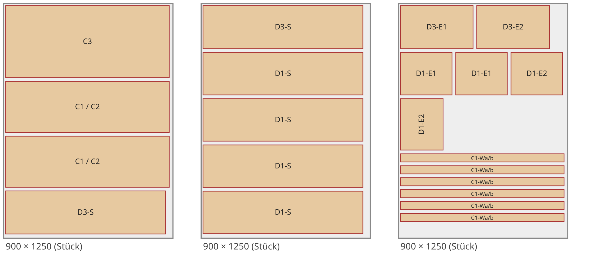
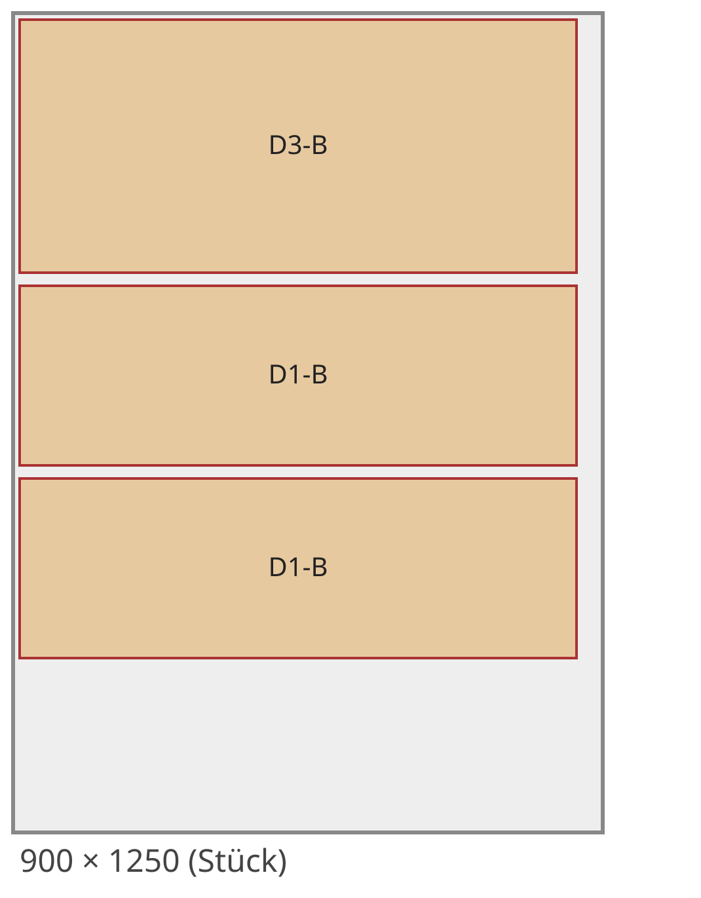

# Plattenoptimum — Schubladen-Auftrag D1–D3 + C1–C3

Erzeugt am 2026-11-21 von `modell/plattenoptimum.py` aus `modell/parameter.json`. Korpus und Liegefläche sind nicht dabei — die Bretter liegen schon zugeschnitten vor (ADR 0032).

Rechnung: Hüllrechtecke der Teile, 20 mm Abstand für den Fräser, 10 mm unbrauchbarer Rand je Platte, MaxRects wie in ADR 0033, bis zu 3 Platten aus den Formaten unten kombiniert. *Ausnutzung* = Hüllrechtecke der Teile / gekaufte Fläche, *Verschnitt* = gekauft − Hüllrechtecke (Fenster, Löcher und Griffe kommen noch dazu, sind aber gewollt). Grobe Schätzung — echtes Nesting des Dienstleisters kann nur gleich gut oder besser sein.

Formate: 2500 × 1250 (Standardplatte, Standard im Holzhandel); 1525 × 1525 (BB/BB-Format, gängig bei Birke-Multiplex (finnisch/baltisch)); 2440 × 1220 (8 × 4 ft, seltener); 3000 × 1500 (Großformat, seltener, eher für große Aufträge); 1250 × 1250 (halbe Platte (quer), Zuschnitt, viele Händler verkaufen halbe Platten); 2500 × 625 (halbe Platte (längs), Zuschnitt); 1250 × 625 (Viertelplatte, Zuschnitt).

## Ergebnis

- **18 mm:** 2440 × 1220 (8 × 4 ft) + 1250 × 625 (Viertelplatte) — 70 % Ausnutzung.
- **12 mm:** 1250 × 1250 (halbe Platte (quer)) — 51 % Ausnutzung.

Zuschnitt-Formate (halbe/Viertelplatte) gibt es nicht überall — vorher beim Händler oder Fräsdienst fragen. Reste aus dem Korpus-Zuschnitt (falls noch da) oder Reste des Dienstleisters können die kleinste Platte ersetzen.

## 18 mm — 21 Teile, 2.62 m² Hüllrechtecke (2.08 m² Holz nach Fenstern/Löchern)

### Faser egal (Teile dürfen quer liegen — so steht es im Auftrag)

| Platten | gekauft | Ausnutzung | Verschnitt | Teile je Platte |
|---|---|---|---|---|
| 2440 × 1220 + 1250 × 625 **← Optimum** | 3.76 m² | 70 % | 1.14 m² | 3 / 18 |
| 1525 × 1525 + 1250 × 1250 | 3.89 m² | 67 % | 1.27 m² | 7 / 14 |
| 1525 × 1525 + 2500 × 625 | 3.89 m² | 67 % | 1.27 m² | 14 / 7 |
| 1525 × 1525 + 1250 × 625 + 1250 × 625 | 3.89 m² | 67 % | 1.27 m² | 5 / 3 / 13 |
| 2500 × 1250 + 2500 × 1250 (nur Standardplatten, Vergleich) | 6.25 m² | 42 % | 3.63 m² | 16 / 5 |

### Faser längs (jedes Teil mit der langen Seite längs der Faser)

| Platten | gekauft | Ausnutzung | Verschnitt | Teile je Platte |
|---|---|---|---|---|
| 2440 × 1220 + 1250 × 625 **← Optimum** | 3.76 m² | 70 % | 1.14 m² | 6 / 15 |
| 2500 × 1250 + 1250 × 625 | 3.91 m² | 67 % | 1.29 m² | 15 / 6 |
| 1250 × 1250 + 2500 × 625 + 1250 × 625 | 3.91 m² | 67 % | 1.29 m² | 8 / 4 / 9 |
| 2500 × 625 + 2500 × 625 + 1250 × 625 | 3.91 m² | 67 % | 1.29 m² | 10 / 9 / 2 |
| 2500 × 1250 + 2500 × 1250 (nur Standardplatten, Vergleich) | 6.25 m² | 42 % | 3.63 m² | 15 / 6 |

## 12 mm — 3 Teile, 0.79 m² Hüllrechtecke (0.71 m² Holz nach Fenstern/Löchern)

### Faser egal (Teile dürfen quer liegen — so steht es im Auftrag)

| Platten | gekauft | Ausnutzung | Verschnitt | Teile je Platte |
|---|---|---|---|---|
| 1250 × 1250 **← Optimum** | 1.56 m² | 51 % | 0.77 m² | 3 |
| 2500 × 625 | 1.56 m² | 51 % | 0.77 m² | 3 |
| 1250 × 625 + 1250 × 625 | 1.56 m² | 51 % | 0.77 m² | 1 / 2 |
| 1525 × 1525 | 2.33 m² | 34 % | 1.53 m² | 3 |
| 2500 × 1250 (nur Standardplatten, Vergleich) | 3.12 m² | 25 % | 2.33 m² | 3 |

### Faser längs (jedes Teil mit der langen Seite längs der Faser)

| Platten | gekauft | Ausnutzung | Verschnitt | Teile je Platte |
|---|---|---|---|---|
| 1250 × 1250 **← Optimum** | 1.56 m² | 51 % | 0.77 m² | 3 |
| 2500 × 625 | 1.56 m² | 51 % | 0.77 m² | 3 |
| 1250 × 625 + 1250 × 625 | 1.56 m² | 51 % | 0.77 m² | 1 / 2 |
| 1525 × 1525 | 2.33 m² | 34 % | 1.53 m² | 3 |
| 2500 × 1250 (nur Standardplatten, Vergleich) | 3.12 m² | 25 % | 2.33 m² | 3 |

## Fräsbett-Variante — Fräse kleiner als eine ganze Platte

Für eine Fräse bei einem Bekannten o. Ä.: Der Holzhändler schneidet die gekauften Platten in Stücke von Fräsbettgröße, gefräst wird Stück für Stück. Das längste Teil ist 870 mm lang — das Fräsbett braucht mit Rand und Abstand mindestens ~900 mm. Die Schnittfuge beim Zuschnitt macht ein Stück ein paar mm kleiner als das Fräsbett — das schluckt der Randstreifen (10 mm). Gekauft wird aus ganzen (2500 × 1250) und halben (1250 × 1250) Platten. Stücke bis ~1120 mm passen quer in den Caddy, ganze Platten nicht.

| Fräsbett | Stärke | Stücke | Ausnutzung der Stücke | kaufen | Reste nach Zuschnitt |
|---|---|---|---|---|---|
| 900 × 1250 (Empfehlung — Teile sind fast alle ~870 mm lang) | 18 mm | 3 × 900 × 1250 | 78 % | 2500 × 1250 + 1250 × 1250 | 1.31 m² |
| 900 × 1250 (Empfehlung — Teile sind fast alle ~870 mm lang) | 12 mm | 1 × 900 × 1250 | 71 % | 1250 × 1250 | 0.44 m² |
| 900 × 1000 | 18 mm | 4 × 900 × 1000 | 73 % | 2500 × 1250 + 2500 × 1250 | 2.65 m² |
| 900 × 1000 | 12 mm | 1 × 900 × 1000 | 88 % | 1250 × 1250 | 0.66 m² |
| 900 × 625 (kleine Hobbyfräse) | 18 mm | 7 × 900 × 625 | 67 % | 2500 × 1250 + 2500 × 1250 | 2.31 m² |
| 900 × 625 (kleine Hobbyfräse) | 12 mm | 2 × 900 × 625 | 71 % | 1250 × 1250 | 0.44 m² |

Reste = gekaufte Fläche − Stücke; taugen für ein Probestück (Zapfen in Schlitz) vor dem Auftrag.

